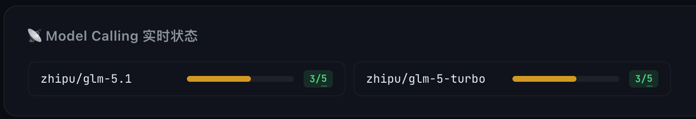
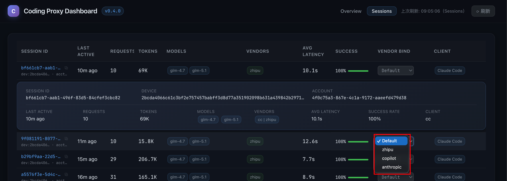

# Changelog

本文件基于 [Keep a Changelog](https://keepachangelog.com/zh-CN/) 规范维护，版本号遵循 [语义化版本](https://semver.org/lang/zh-CN/)。

## [v0.6.6](https://github.com/ThreeFish-AI/coding-proxy/releases/tag/v0.6.6) - 2026-11-25

> 本版主轴：Overview「订阅状态」卡片统一为单行用量格语法，文字与图形收敛成一套；用量窗口补结构化字段。

- feat(dashboard): **订阅状态卡片统一用量格语法并保证单行**：胶囊只承载状态，用量统一为「窗口短标签 + 进度条 + 百分比（订阅窗口再缀重置倒计时）」的用量格，底色与进度条按用量转黄、转红；窗口标签三家同一套（`5h` / `周` / `1d` / `7d`），Antigravity 四个窗口按模型族 `Gemini` / `Claude+GPT` 分组、组内先 5h 后 周；档位改为行名后的加粗亮字，与行名相同时不再重复显示；行名列定宽、订阅区左对齐、路由区分隔线对齐；视口宽于 960px 时每行始终单行，放不下时只在订阅区内横向滚动并保留滚动位置（#312）；
- feat(subscription-status): `GET /api/dashboard/subscriptions` 的用量窗口补 `window`（窗口类别）与 `group`（模型族短名）字段，前端不再拆上游字符串，`id` / `label` 不变（#312）；
- docs(dashboard): README 首图同步新样式，版本徽标更新为 v0.6.6（#312）；

## [v0.6.5](https://github.com/ThreeFish-AI/coding-proxy/releases/tag/v0.6.5) - 2026-11-24

> 本周期主轴：Dashboard Overview 的「订阅状态」与「供应商状态」合并为一张卡片，同一个账号一行；修复拖拽卡死与图表空态刷新两个存量缺陷。

- feat(dashboard): **Overview「🎫 订阅状态」与「供应商状态」合并为一张卡片**：同一账号一行（GLM ↔ zhipu、Claude ↔ anthropic、Antigravity ↔ antigravity），竖线左侧为订阅档位与用量窗口，右侧为该供应商的熔断 / 配额守卫 / 限速徽章；行序等于路由优先级，无路由 tier 的订阅行排在最后且不可拖拽，无订阅对应的供应商行以灰字「供应商状态」标注；原供应商卡片所在的一列让给请求量趋势图；「⟲ 状态复位」迁入卡片标题栏，仍走无 body 的 `POST /api/reset`（#307）；
- fix(dashboard): 供应商行拖拽到列表外松开后卡死：行被 DOM 重排后丢失指针捕获，收尾事件不经过列表，被拖行停在半透明且列表不再刷新；改为重排后补捕获、收尾监听挂 `document`、拖拽中忽略第二个指针（#307）；
- fix(dashboard): 无用量数据时图表空态替换掉 canvas，第二次刷新起抛 TypeError、页面显示「刷新失败」：canvas 恒留在 DOM 中，空态只隐藏它（#307）；
- feat(dashboard): 拖拽手柄改为可聚焦按钮，Tab 聚焦后按 ↑ / ↓ 调整优先级，焦点留在原行；供应商行头像首字母与订阅行撞字母时取前两个字母（copilot → Co）（#307）；
- docs(dashboard): README 首图更新为合并后的 Dashboard Overview 并改为绝对地址（PyPI 项目页上也能显示）；`docs/guide/dashboard.md` 新增「订阅状态」小节，`docs/arch/subscription-status.md` 新增「卡片行模型」，`docs/guide/api-reference.md` 补 `GET /api/dashboard/subscriptions`（#307、#309）。

## [v0.6.4](https://github.com/ThreeFish-AI/coding-proxy/releases/tag/v0.6.4) - 2026-11-16

> 热修复：订阅状态面板 Antigravity 行回归。

- fix(subscription-status): 修复 **Antigravity 订阅状态永远显示「未启用」**——config resolver 会为未显式配置的用户合成 `enabled=False` 的默认 antigravity 条目，v0.6.3 的「显式禁用即不查」门把该合成条目误判为用户显式禁用，token store 有 google 凭证也被挡死（仅用 IDE gateway 透传、vendor 未启用的主场景全部命中）；回退路径改按凭证可得性判定（token store google refresh_token 或 config 显式凭证即查），`entry.enabled` 只管路由参与不管订阅展示，zhipu 判定不受影响；真机复测 Antigravity 恢复 ok（Gemini weekly 25.6% / 5h 0.2%）（#304）；

## [v0.6.3](https://github.com/ThreeFish-AI/coding-proxy/releases/tag/v0.6.3) - 2026-11-16

> 本周期主轴：Dashboard Overview 新增「订阅状态」面板，聚合展示 Claude Code / GLM / Antigravity 三家订阅的档位与真实配额用量。

- feat(subscription-status): 新增 **Overview「🎫 订阅状态」面板 + `GET /api/dashboard/subscriptions`**——三家订阅档位与用量聚合（TTL 120s 缓存、per-vendor 错误隔离、错误同样入缓存防刷新风暴打未文档化端点）：**GLM** 用已配 api_key 主动查智谱官方监控端点（裸 key 鉴权、`data.level` 档位 + 5h/周窗已用百分比与重置时间，percentage/used_percent 双字段形态防御式解析）；**Antigravity** 用 OAuth token 主动查 `v1internal:loadCodeAssist`（档位 + cloudaicompanionProject，缓存 1h）+ `retrieveUserQuotaSummary`（Gemini / Claude+GPT 分组双窗口剩余比例），客户端指纹与上游 host 复用仓内权威常量（UA 门控必需，配额 host 尊重 `antigravity_gateway.base_url` 覆写），凭证 vendor 通道优先、config + token store 回退合成；**Claude Code** 走 unified ratelimit 响应头被动采集（`BaseVendor._on_upstream_response` 新钩子 + 进程级快照，透传链路零凭证零影响，档位不展示属已知边界）；未预期异常对齐 I2 canon（类型 + 堆栈帧），上游错误收敛短消息不携凭证；数值守门拒绝 NaN/Infinity（畸形值仅丢弃对应窗口不拖垮整家）；前端卡片复用既有 quota 徽章/进度条组件，上游字符串全量 escapeHtml（Node 行为测试含 XSS 用例）；真机实测三家真实数据，Claude 被动行待正式实例首个 CC 请求点亮（#301，经 review-once 两轮收敛 14 项 Findings 全修复、独立 fresh-context 复审无 Finding）；
- docs(antigravity-gateway): 纠偏通道③覆盖范围——桌面 2.32.1 模型流不经 `CLOUD_CODE_URL`，模型级统计指引收敛至通道②（#299）；

## [v0.6.2](https://github.com/ThreeFish-AI/coding-proxy/releases/tag/v0.6.2) - 2026-11-16

> 本周期主轴：新增 Antigravity IDE 客户端透传通道；Model Bind 下拉升级为内置 vendor 目录合成 + vendor.model 锁定；修复新会话标题永久缺失。

- feat(antigravity-gateway): 新增 **Antigravity IDE 客户端透传通道**——`/api/antigravity/**` catch-all 端点（默认启用，开箱即用），Antigravity 桌面端与 `agy` CLI 经未文档化 env hook `CLOUD_CODE_URL` 将模型流指向本 proxy，字节级透传至 Google Cloud Code `v1internal` 后端并旁路解析信封完成用量统计（`client_category='antigravity'`，vendor 标签 `antigravity-gateway`），认证由 IDE 自带、proxy 不保管凭据；新增 `AntigravityGatewayConfig`（`enabled` / `base_url` / `timeout_ms` / `connect_timeout_ms`，上游域名漂移可经 `ANTIGRAVITY_GATEWAY_BASE_URL` 覆写，优先级 env > YAML > 内置默认，空串视作未设置）；三条接入通道裁决矩阵与调研背景见 `docs/research/antigravity-client-feasibility.md`（#294）；
- feat(model-catalog): Model Bind 下拉从静态 `bindable_models` 清单升级为**内置 vendor 目录合成 + vendor.model 锁定**——新增 `vendors/model_catalog.py` 内置目录（anthropic claude 家族 10 档 / zhipu glm 家族 9 档 / minimax、kimi、doubao、xiaomi、alibaba 各家），app 构建时按激活 vendor 过滤后与 config 显式条目合成（按 model 去重、config 覆盖 label/tiers、`exclude` 剔除内置条目、空清单 = 整体关闭）；目录内 native 系模型自动合成 `pattern=target` identity 映射规则（用户显式规则已覆盖的模型跳过），免疫 default 静默改写与跨 vendor 透传 400；绑定语义为 vendor.model 直接锁定（executor 严格链 `_pinned_tier_names` + `_try_gate_tier` 模型门控），锁定 vendor 全体不可用时请求显式失败；前端下拉按 vendor optgroup 分组，Config 页 bindable 编辑器加 Exclude 列（#296）；
- fix(session-title): 修复新会话标题永久缺失（Dashboard 显示「-」）——根因为 CC 会话首请求常为内部标题探测 prompt，被 `title_exempt_prefixes` 全层级豁免后提取为空、`session_meta` 行从未创建，纯 UPDATE 对缺失行静默 no-op；标题写者统一为单一 `set_session_title` 幂等 upsert（行缺失补建/空标题更新/已有标题不动），executor 以 written 门控 `_apply_title_based_policy`；内建 CC 标题探测识别（剥 `<session>` 壳与指令取内嵌真实首条输入，首个请求即刻产出业务标题），`title_exempt_prefixes` 默认清零（机制保留作逃生门）；顺带修复延迟补写从不触发 title_vendor_bindings、compat TTL 过期重判新会话时已删运行时绑定被复活（#295）；

## [v0.6.1](https://github.com/ThreeFish-AI/coding-proxy/releases/tag/v0.6.1) - 2026-11-16

> 本周期主轴：Dashboard Sessions 页「Vendor Bind」升级为「Model Bind」，支持对运行中的 Claude Code 会话在不打断任务执行的前提下切换实际所用模型（含跨系列）。经 7 轮独立 Review-Fix 循环收敛（16 项缺陷修复）。

- feat(session-model-bind): 新增**会话级模型绑定**——`SessionPolicy` 增可选 `model` 字段，绑定后该 Session 的后续请求体 `model` 统一改写（shadow copy，逐请求生效），在途请求按旧捕获值完成、下一请求即时按新值路由，任务执行零打断（隔离实例 + mock 上游实验 15/15 断言实证）；Dashboard「Vendor Bind」列整体替换为「Model Bind」（选项来自新配置 `session_policies.bindable_models` 清单，默认 claude 三档零额外配置；Default = 清除整条绑定，vendor-only 绑定以 `Default (vendor: …)` 标注可见）；跨系列原生模型名（如 `glm-5.3`）入清单需配套 identity `model_mapping` 规则，防 `ModelMapper` default 静默改写；CLI `session bind` 增 `--model`（与 `--vendor` 可组合）；`PUT /api/session-vendor` 增可选 `model`（清单外 400，清单为空时报错指向根因配置项），`GET` 回显 model、`/api/status` 增返 `bindable_models`；
- fix(session-policy): 修复**标题前缀自动绑定覆盖手动绑定**的既有缺陷——`_apply_title_based_policy` 遇已有运行时绑定即跳过（compat TTL 24h 过期导致长会话被重新判定为新会话时同样受保护）；仅绑模型（tiers 为空）时 resolver 继承链按「现有运行时绑定 > key 级配置备份 > category 配置」兑现「不改 vendor 顺序」承诺，PUT 响应回显继承后的生效 tiers/model；
- feat(model-mapper): `ModelMapper` 增 `map_with_reason`（exact / pattern / default），`BaseVendor` 新增 `map_model_with_reason` 扩展点（native 系与 antigravity 覆写真实命中原因）——会话模型漂移告警据此区分「配置内等价映射」（如 claude 档位名 → glm 档位名，不告警）与「default 回退改写 / 上游换名」（WARNING，缺规则场景附 identity 规则修复指引），默认配置主路径零告警噪声；
- fix(generations): **配置热切换（generation swap）迁移保留模型绑定**——`_migrate_bindings` 由只搬 vendors 扩为三元迁移（vendor 需仍在新链路、模型需仍在 `bindable_models` 清单，单侧失效降级保留另一侧），`reset_runtime` 对称提示整条移除 / vendor 侧降级 / 模型侧降级，文案不再预设绑定含模型；
- feat(config-ui): Config 页 Session Policies 分区交付 `bindable_models` 清单编辑（Label/Model/Tiers 三列 listBlock）与策略条目的 `Model` 覆盖字段（`policies.*.model` 空串清空归一为未设置，不再 422 卡死）；config ui_registry 覆盖门同步登记 5 个新叶子；
- docs: 新增 `arch/session-model-bind.md` 设计与实现锚点（数据流、配置、API/CLI、UI、风险边界、测试锚点）；`arch/config-reference.md` 补 §11 session_policies 节（含生命周期口径：重启回落配置态、热切换迁移保留）；`arch/vendors.md` 补 `map_model_with_reason` 方法契约；
- test: 补齐 30+ 守护用例——resolver 继承链与 model 语义、在途请求隔离（流式 / 非流式）、漂移告警三分支与负向控制、路由级 PUT/DELETE/GET 全分支、默认清单加载守护、CLI payload、热切换迁移计数、Config 页渲染契约；

## [v0.6.0](https://github.com/ThreeFish-AI/coding-proxy/releases/tag/v0.6.0) - 2026-11-14

> 本周期主轴：配置系统由 YAML 迁移至 `config.db` + Dashboard Config 页（含管理面安全加固）。以下条目按重要程度排列。

- feat(config): 运行时配置源迁移至 **`$CODING_PROXY_HOME/config.db`**（默认 `~/.coding-proxy/config.db`；sqlite3、0600、密钥 Fernet 加密、主密钥 `master.key`），`config.default.yaml` 退化为随包发布的默认值基线；新增 `config/{home,defaults,normalize,store,secrets,resolver,importer,service,ui_registry}.py` 核心层与 `coding-proxy config`（`path` / `export` / `import` / `set` / `reset` / `set-secret` / `token`）子命令；写入走 per-section revision 乐观并发（冲突 409），旧 `config/loader.py` 搜索链保留为导入参考实现与等价基准、运行时不再读取；
  - **升级迁移（一次性导入）**：首次 `start` 自动导入 `~/.coding-proxy/config.yaml`（或 `start -c FILE` 指定源），导入前跑旧 loader 等价校验（`ProxyConfig` 全等，不通过则以旧 YAML 只读运行、Config 页禁写）；源文件不改名不改写，marker 记 sha256；此后的拒启（strict）仅限 `start -c` 显式文件、旧搜索链候选（`./config.yaml` / `~/.coding-proxy/config.yaml`，含其中即导入源的情形）、或无导入源时的上述候选与已导入版本不一致，其余来源（如另行 `config import` 的自定义路径）仅提示；
  - **Breaking**：`./config.yaml` 不再被自动导入（防止第三方仓库目录下的文件被误当全局配置，首启存在时以专门话术拒启并指引 `start -c` / `config import`）；「`cp config.default.yaml config.yaml` 后编辑」的旧流程整体废弃；`-c` 语义由「常规启动配置源」变为「一次性迁移导入源」；
  - **密钥只写不读**：GET 仅返回 `{kind(stored/env/empty/default), env_var?, resolved, hint(尾 4 位), default_env?, recorded}`；写入用 op（`set` / `clear` / `default_env` / `env`，任意 env 绑定仅 CLI）；vendor 的 `base_url` / `token_url` 变化时自动清空未显式保留的密钥（防密钥发往新目标，仅限有存储记录且新目标非包内默认端点的密钥）；bootstrap 字段（`server` / `logging` / `database` / `auth` 路径类）HTTP 只读，仅 CLI `config set` 可改、需重启生效；
- feat(dashboard): 新增 **Config 页**在线编辑全部配置（Vendors / Tiers / Failover / Model Mapping / Pricing / Native API / Session Policies / System 分区，密钥三态控件，保存确认框列出将被重置的运行态与被清空的密钥，409 只重载冲突 section、422 行内定位且从不回显输入值）；保存经进程内 **generation swap** 热切换生效（新配置先 preflight 构建再原子切指针，旧 generation 等待 in-flight 请求排空后关闭，上限 600s，长流式请求不受影响），无需重启；存储的配置无效时以 degraded 模式启动（仅 Dashboard 与管理 API 可用，代理接口 503 并指引修复）；
- feat(security): 管理面安全加固——`/api/config*` 需 `X-Coding-Proxy-Admin` 请求头（token 存于 0600 `admin_token` 文件，`config token` 查看，常量时间比较，不接受 cookie/query）；新增纯 ASGI 安全中间件：L1 全局拒绝跨站浏览器请求（`Sec-Fetch-Site` / `Origin` 校验，同时堵住既有 `POST /api/reset`、`/api/reauth/*` 的 CSRF），L2 管理面 Host 白名单（回环地址 + 新 bootstrap 字段 `server.allowed_hosts`，防 DNS rebinding）；关闭 `/docs` / `/redoc`；非 dashboard 响应统一加 `CSP: sandbox` + `nosniff`；`uvicorn` 设 `proxy_headers=False`；修复 Dashboard 图表 tooltip 与 vendor name 的既有 XSS 汇点；
- security(config): 密钥泄露路径加固（I2：密钥明文不经 HTTP 响应 / 日志 / 异常离开进程）——`set` 写入边界拒绝含控制字符或非 Latin-1 字符的密钥值（422「密钥包含非法控制字符」，此类值会成为非法 HTTP header 并被异常消息携带）；`/v1/messages` 流式与非流式路径的未预期异常响应改为只含异常类型名（原 `f"{type}: {exc}"` 会把 httpx 拒绝的非法 header value（内嵌密钥明文）回显给未认证客户端）；executor / routes / TokenManager 的未预期异常日志改为「类型 + 堆栈帧」，不再记录 `str(exc)`；
- fix(config): `config_section` 行内数据不是有效 JSON（外部改动 / 文件损坏）时，`start` 映射为 `StoreCorruptError` 一行提示 + 退出码 2（原为裸 `JSONDecodeError` traceback）；`usage --db` 正确覆盖用量数据库路径（原被当作配置文件路径传入 `load_config`）；
- fix(dashboard): `/api/status` 的 `in_flight` 扣除发起查询的请求自身，空闲代理的保存确认框不再显示「进行中的请求：1 个」；离开 Config 页签时清除 URL 残留的 `section` 查询参数（避免复制分享的链接把他人带偏定位）；
- refactor(auth): `RuntimeReauthCoordinator` 类文档显式标注与 `server/generations.py` 的私有属性交接契约（`_providers` / `_states` / `_locks` 等 7 个属性，重命名 / 加 `__slots__` 需同步 `_relay_reauth` / `_finish_relay` / `_forward_tokens`）；
- docs: 用户文档面整体切换到 config.db 口径——重写 `arch/config-reference.md` 为「解析管线 + 存储 + 一次性导入」SSOT 口径（默认 ⊕ 覆盖 ⊕ 密钥注入 → `$tmpl` 展开），同步 `guide/{quickstart,cli-reference,dashboard,api-reference,monitoring}`（cli-reference 新增 `config` 子命令、api-reference 新增「配置管理端点」）、`user-guide`、`README` 与 `zh-CN` 镜像；修正 `circuit_breaker: None` 的语义描述（不启用熔断，兜底由 tiers 位置决定，而非「终端层」）；`GET /api/config` 的 secrets 状态补充 `default_env` / `recorded` 字段与 `kind=default` 态的描述；

## [v0.5.2](https://github.com/ThreeFish-AI/coding-proxy/releases/tag/v0.5.2) - 2026-09-10

- fix(quota-guard): `coding-proxy reset` / `POST /api/reset` 不再清空配额守卫的滑动窗口用量——根因是 `QuotaGuard.reset()` 把「状态机复位」与「用量计数清零」耦合在一个方法里（`_entries.clear()` + `_total = 0`），而窗口基线 `load_baseline()` 的唯一调用点在进程启动的 lifespan 钩子中、运行期不再回填，导致 Dashboard 的 `1d配额 45%` 徽章复位后永久停在 0%；现 `reset()` 只保留 `_transition_to(WITHIN_QUOTA)`（该方法本身已清 `_cap_error_active` 并还原探测间隔），CLI / API / Dashboard 三条路径经单一事实源同时修复。语义取舍为**如实**：用量确已超过 `token_budget × threshold_percent` 时守卫保持 `QUOTA_EXCEEDED`（不伪造用量数字），但仍清除上游 cap 错误卡死标志并把被 `Retry-After` 拉长的探测间隔还原为默认值——刻意不走 WITHIN_QUOTA → QUOTA_EXCEEDED 回环，因为 `_transition_to(EXCEEDED)` 会把 `_last_probe` 刷成当前时刻，令探测恢复凭空推迟一个 probe_interval，反复复位即可饿死探测（PR 评审发现的回归，补 2 条用例锁定）；文档口径（`cli-reference.md` / `api-reference.md`）同步补明「仅复位状态、不清用量」；
- feat(dashboard): Overview 页「供应商状态」卡片标题栏右侧新增 **⟲ 状态复位** 按钮，一键把处于熔断 / 限流等异常态的供应商复位为可正常访问——调用无 body 的 `POST /api/reset`，因此**不触发重排序、不改动供应商优先级**，配合上述配额修复亦**不清空额度用量**；新增 `.btn-card-action` 卡片标题栏控件通用类（复用 `.card-title` 既有的 `justify-content: space-between`，零布局 CSS 改动）并纳入 `:focus-visible` 焦点环列表；交互沿用 `persistTierOrder` 的 in-flight 防并发范式与 `copyFromParent` 的瞬时反馈范式（复位中… → ✓ 已复位 / ✗ 失败，1.5s 还原），成功后定向重渲染供应商列表而不必等 10 分钟轮询；定向刷新 `/api/status` 失败时单独吞掉、不误报「✗ 失败」诱导重复点击（复位已生效，刷新失败仅影响展示）（实机验证）；
- fix(dashboard): 修复「限速中」徽章从未渲染的问题——前端读 `rlInfo.limited`，而后端 `VendorTier.get_rate_limit_info()` 产出的键是 `is_rate_limited`，键名不匹配使 Rate Limit 异常态在 UI 上完全不可观测；补前端守卫测试锁定键名；

> [!NOTE]
> 本版为 v0.5.2 周期（v0.5.2a1–a8）的正式收口版，完整变更见上方各 alpha 段落；以下条目为 v0.5.2a8 之后的增量（#279）。

## [v0.5.2a8](https://github.com/ThreeFish-AI/coding-proxy/releases/tag/v0.5.2a8) - 2026-07-06

- fix(vendor-logging): 修复流式 4xx/5xx 错误日志中文乱码——根因是 `logger.warning("...body=%s...", error_body[:500])` 对 `bytes` 走 `repr()`，非 ASCII 的 UTF-8 字节被转义为 `\xe6\x82\xa8` 之类不可读序列（上游限流/鉴权等中文错误信息无法辨认）；新增 `decode_error_body(raw, limit=500)` 工具（`errors="replace"` 容错解码、先整体解码再按字符截断以避免在多字节 UTF-8 边界切断产生二次乱码，`limit` 语义为字符数），`base.py` / `copilot.py` / `antigravity.py` 三处流式错误日志统一收敛，并经 `model/__init__` 与 `vendors/base` 导出复用 (#278)；
- fix(vendor-antigravity): 流式 scope 检测改用完整解码 body，与日志展示的 500 字符截断解耦——此前 `decode_error_body` 截断后的文本被同时喂给 `_mark_scope_error_if_needed` 子串检测，当 `ACCESS_TOKEN_SCOPE_INSUFFICIENT` 标记位于第 500 字符之后时会被截断丢弃，token 不再标记 `needs_reauth` 而持续以 scope 不足的凭证重试；现检测改用 `error_body.decode("utf-8", errors="replace")` 完整文本、日志展示仍用 500 截断，恢复与非流式路径（`send_message` 传完整 `response.text`）的行为一致性；补回归测试（构造标记位于 500 字符之后的 403 错误体，断言检测仍触发，旧截断实现下该用例失败）(#278)；

## [v0.5.2a7](https://github.com/ThreeFish-AI/coding-proxy/releases/tag/v0.5.2a7) - 2026-07-04

- style(dashboard): Overview 页 6 张 KPI 卡片（今日请求数 / Token 总量 / 输出 Token / 费用估算 / 故障转移 / 平均延迟）固定单行不折行——`.kpi-grid` 由 `repeat(auto-fit, minmax(200px, 1fr))`（视口 < ~1289px 即减列换行）改为 `repeat(6, minmax(0, 1fr))`，`minmax(0,…)` 覆盖 grid 默认 `min-width:auto` 杜绝内容撑列引发的横向溢出，桌面/笔记本/平板横屏（≥1024px）恒定 6 列单行；`gap` 由 off-grid 的 `5px` 归一为 `--gap-section`（12px）；`.kpi-value` 采用 `clamp(20px, 2.2vw, 32px)` 平滑缩放使中宽度不裁剪数值，费用卡 `#kpi-cost-today` 允许在 `" + "` 处换行使双币种始终完整可见；新增 ≤1023px→3 列、≤480px→2 列 优雅降级，`header` 补 `flex-wrap` 修复窄屏横向溢出（Playwright 8 档宽度实测：1440/1280/1024px 均 6 列单行、无横向滚动、无数值裁剪）(#276)；
- a11y(dashboard): 为 `.range-btn` / `.btn-refresh` / `.page-btn` / `.copy-btn` 补 `:focus-visible` 键盘焦点环，统一交互元素键盘可达性；新增 `@media (prefers-reduced-motion: reduce)` 降级 `fadeInUp` 动画与 hover 过渡，照顾前庭敏感用户 (#276)；
- fix(dashboard): 补定义 `--bg-secondary` / `--text-muted` 两个此前**未定义**的 CSS 变量（消除 `.mc-model-row` / `.mc-empty` 背景与文字色回退瑕疵）；Google Fonts 补载 JetBrains Mono `700` 字重，修正 `.kpi-value` 合成粗体渲染 (#276)；
- docs(readme): 页脚补充作者主页（ThreeFish-AI）与 Apache License 2.0 开源协议超链接；

## [v0.5.2a6](https://github.com/ThreeFish-AI/coding-proxy/releases/tag/v0.5.2a6) - 2026-07-04

- style(branding): 品牌图标（logo/favicon）迭代至「通透青绿圆环 + Tabler prompt `>_` 笔划」（方案 d05）：全透明底 + 青绿渐变（`#22d3ee` → `#2dd4bf`）细圆环（stroke 0.5，仅原 1/3、通透若隐）+ 饱和青绿渐变 `>_`（stroke 2.5），极细环与饱和笔划形成权重对比、`>_` 为视觉主角，青绿承载终端/代码语义；基础笔划改用 Tabler prompt（chevron `M5 7l5 5l-5 5` + 下划线 `M13 17l6 0`，下划线长 6 单位、不会小尺寸点化）；渐变改 `gradientUnits="userSpaceOnUse"` 绝对坐标，修复纯水平下划线（包围盒高度 0）在默认 objectBoundingBox 渐变下不着色而「消失」的问题；`_LOGO_DEFS` / `_PROMPT_PATHS` 单一事实源统一供 SVG favicon、ICO 回退（省略 0.5px 细环、保留饱和笔划）与页面 logo 消费；`.logo` 容器改全透明、SVG 内嵌圆环 + 青绿 drop-shadow 辉光（实机验证）(#274)；
- style(branding): 品牌图标醒目度前置优化（同主题演进过程，已并入本版）：容器由「淡色磨砂卡片」改为「玻璃雾卡」（半透明白 + hairline 描边环）与深色毛玻璃 header 语言统一、消除「亮白贴片」压制感，`>_` 笔划加粗 stroke-width 2→2.5 并撑开间距避免粘连、防止下划线小尺寸退化为圆点 (#274)；

## [v0.5.2a5](https://github.com/ThreeFish-AI/coding-proxy/releases/tag/v0.5.2a5) - 2026-07-04

- fix(dashboard): 供应商队列拖拽由原生 HTML5 DnD 改为 Pointer Events 实现，修复 v0.5.2a4 引入的拖拽排序功能在浏览器中无法拖动的问题；引入 4px 拖拽阈值、乐观实时重排与指针捕获机制，同步支持触屏设备；拖拽完成后顺序立即影响 cc 运行时供应商优先级调度（实机验证）；为 `/dashboard` 响应增加 `Cache-Control: no-cache`，防止浏览器缓存旧内联脚本；补齐前端守卫测试断言 (#271)；
- style(branding): 重设计 logo/favicon 为 `#f5f6fb` 淡色磨砂卡片 + 品牌渐变（`#667eea` → `#764ba2`）`>_` 笔划 + 半透明细描边环，轮廓成为视觉主角、小尺寸下更清晰（Linear/Vercel 风）；抽取 `_LOGO_DEFS` 作为品牌渐变 `<defs>` 单一事实源，统一供 SVG favicon、ICO 回退与页面 logo 消费 (#272)；

## [v0.5.2a4](https://github.com/ThreeFish-AI/coding-proxy/releases/tag/v0.5.2a4) - 2026-07-03

- feat(dashboard): 供应商状态模块支持拖拽调整供应商优先级，新增纯重排序端点 `PUT /api/tier-order`（复用 `router.reorder_tiers`，不重置熔断器/配额守卫/rate limit），拖拽后配额与用量统计保持当日值不变；与 `reset -v` 同源、运行时内存生效，失败自动回滚至服务端真实顺序 (#269)；
- feat(session): 扩充标题豁免前缀，新增 `[Session]` 过滤注入式 Prompt 候选；
- chore(pricing): 更新智谱 GLM-5.2 模型定价配置；

## [v0.5.2a3](https://github.com/ThreeFish-AI/coding-proxy/releases/tag/v0.5.2a3) - 2026-07-02

- fix(session): 标题豁免前缀扩展至全层级兜底标题，修复 `[Session] <model>` 等 Level 4 合成标题无法豁免（原 `title_exempt_prefixes` 仅 Level 1 生效）；改为在 `_extract_session_title` 编排层对 L1/L2/L3/L4 候选统一拦截，命中回退、全豁免返回空串待后续真实输入回填，默认行为零影响 (#267)；

## [v0.5.2a2](https://github.com/ThreeFish-AI/coding-proxy/releases/tag/v0.5.2a2) - 2026-07-02

- feat(session): 新增 Session 标题豁免前缀配置 `title_exempt_prefixes`，过滤注入式 Prompt（典型如 "Write the title in the language the user wrote in..."）被误用为 Session 标题；首条 user 输入经噪声剥离后命中豁免前缀则跳过、继续向后查找 title 候选，Level 2/3/4 回退不受影响 (#265)；

## [v0.5.2a1](https://github.com/ThreeFish-AI/coding-proxy/releases/tag/v0.5.2a1) - 2026-06-30

- fix(zhipu): 将 429/529 兜底退避抖动从 Full Jitter 改为 Equal Jitter（`[0, ceiling]` → `[ceiling/2, ceiling]`），修复 529 过载重试延迟非单调（实测 418.8→1857.7→961.6→3769.7ms）问题，重试延迟呈单调非递减指数形态；429 与 529 共用退避路径同步受益，server `retry-after` 优先级不变 (#263)；
- feat(dashboard): Model Calling 实时监控扩展至全 vendor / 全 model（仅 CC 场景），其他 vendor 在 monitor 模式下仅计数不限流，Zhipu 保留 limited 模式 + FIFO 排队；
- feat(concurrency): 新增 `peak_pending_recent` 最近 10s 排队峰值追踪，瞬时排队释放后前端仍可见"曾排队 N" 余晖徽章；
- perf(dashboard): Model Calling 轮询间隔由 5000ms 缩短至 1500ms，提升瞬时排队可观测性；
- refactor(vendors): `ModelConcurrencyLimiter` 重构为 `ModelConcurrencyController`，统一 monitor / limited 双模式抽象（保留旧名别名）；并发控制由 vendor 内部迁移至 executor 层 `track_in_flight` 包裹，行为对所有 vendor 一致；

> [!NOTE]
> 本版另补记 v0.5.1 Release Note 遗漏的 4 项并发与监控改动（feat/perf/refactor，代码已随 v0.5.1 上线，文档此前未记录）。

## [v0.5.0](https://github.com/ThreeFish-AI/coding-proxy/releases/tag/v0.5.0) - 2026-05-27

> [!IMPORTANT]
>
> **🚀 Model Calling 实时状态！**
>
> 模型并发与排队深度一目了然，运行时动态调整每个模型并行度，预防 vendor 侧的 429 幺蛾子。

### ✨ 核心亮点

- feat(concurrency): 新增 Model Calling 实时状态模块，可视化每模型并发与排队深度，支持运行时动态修改每模型并行度 (#250) (#251)
- feat(zhipu): 新增每模型并发限制，默认 3 个并行请求 FIFO 排队 (#248)
- feat(zhipu): 为 429 Rate Limit 添加指数退避重试挽回机制 (#242)

### 🔧 更多特性

- fix(antigravity): 修复 v1internal 模式检测逻辑并新增 E2E 测试; (#234)
- fix(routes): 修复 count_tokens 路由对 target_vendor.name 的错误属性访问; (#235)
- fix(vendor-channels): 修复 zhipu→anthropic 通道 tool_use/tool_result 配对漏洞; (#236)
- fix(native-api): 修复 Gemini :verb 路径中 %3A URL 编码导致上游 400 的兼容问题; (#237)
- fix(zhipu): 诊断首选 tier 语义拒绝降级问题，增强可观测性并提取跨供应商清洗共享函数 (#243)

## [v0.4.0](https://github.com/ThreeFish-AI/coding-proxy/releases/tag/v0.4.0) — 2026-05-01

> [!IMPORTANT]
>
> **🚀 Session 级专属路由策略！**
>
> 给每个 Session 指定专属的 vendor，动态调节不同 vendors 间的 LLM 流量。

### ✨ 核心亮点

- feat(session-policy): 新增 Session 级专属路由策略 (#219)
- feat(dashboard): 新增会话活动面板 (#222)

### 🔧 更多特性

- refactor(logging): 移除已被 ModelCall 汇总行覆盖的冗余 DEBUG 日志 (#203)
- style(dashboard): 加宽图表 tooltip 令模型名称与用量值单行显示 (#211)
- fix(usage-parser): 补充 OpenAI/Gemini SSE 流式分支的 model_served 提取 (#214)
- fix(usage-parser): 兼容 SSE chunk 中 usage 字段为 null 的极端格式 (#212)

## [v0.3.0](https://github.com/ThreeFish-AI/coding-proxy/releases/tag/v0.3.0) — 2026-04-20

> [!IMPORTANT]
>
> **🚀 OpenAI、Anthropic、Gemini 原生 API 进驻 Coding Proxy！**
>
> 服务对象不在局限 Claude Code，凡兼容 OpenAI、Anthropic、Gemini 三巨头 API 协议的客户端，出口 LLM 流量可统一收敛到 Coding Proxy。

### ✨ 核心亮点

- feat(native-api): 新增 `/api/{openai,gemini,anthropic}/**` 原生 LLM API 全量 catch-all 透传通道；
- feat(dashboard): 新增实时 Web Dashboard 页面，聚合展示流量与用量统计;
- feat(usage): `usage` 区分 Claude Code 场景（`'cc'`）与原生 API 场景（`'api'`）；
- refactor(vendor-channels): 将供应商转换通道从目标专属重构为源→目标绑定模型;
- docs(user-guide): 补充 POST /v1/messages 完整 API 参考文档;

### 🔧 更多特性

- feat(server): 默认监听端口 `8046` → `3392`，规范化 [Negentropy](https://github.com/ThreeFish-AI/negentropy) 体系端口；

## [v0.2.3](https://github.com/ThreeFish-AI/coding-proxy/releases/tag/v0.2.3) — 2026-04-16

- feat(dashboard): 新增实时 Web Dashboard 页面，聚合展示流量与用量统计;
- docs(user-guide): 补充 POST /v1/messages 完整 API 参考文档;
- fix(request-normalizer): misplaced tool_result 从剥离改为重定位，修复跨供应商降级后 Anthropic 恢复失败;

## [v0.2.2](https://github.com/ThreeFish-AI/coding-proxy/releases/tag/v0.2.2) — 2026-04-13

- feat(reset): CLI reset 命令新增 -v/--vendor 参数，支持运行时 N-tier 链路重排序（逗号分隔的 vendor 列表）;
- fix(logging): 修复 uvicorn.error 日志在文件中重复打印的问题;

## [v0.2.1](https://github.com/ThreeFish-AI/coding-proxy/releases/tag/v0.2.1) — 2026-04-11

- feat(logging): 实现日志双写（控制台 + 本地文件），日志文件支持 5MB 自动轮转及 gzip 压缩备份；ModelCall 日志降级为 DEBUG 级别；
- feat(circuit-breaker): 补全熔断器状态转换日志的 vendor 上下文信息;

## [v0.2.0](https://github.com/ThreeFish-AI/coding-proxy/releases/tag/v0.2.0) — 2026-04-09

> [!IMPORTANT]
>
> **🚀 供应商大扩军 × 用量仪表盘全面进化，双线暴击！**
>
> 卡在一家供应商的限额天花板下抬不起头？现在你手握 **九条命**——新增 MiniMax、小米 MiMo、阿里千问、Kimi、豆包五路援军，全部原生讲 Anthropic 话，无缝接入 N-tier。 Token 烧到哪儿心里没数？新版 `usage` 命令解锁日/周/月/全量四档视角，多供应商并排比，汇总行一行看全局。**备用仓更满，账单更透，从此宕机只是别人家的故事。**

### ✨ 核心亮点

- **5 家供应商集体入场**：MiniMax、小米 MiMo、阿里千问、Kimi、豆包（火山引擎）正式入编 N-tier。备用通道数量直接翻倍，不怕堵；
- **`usage` 命令全面升级**：从"只有天数"进化为**日 / 周 / 月 / 全量**四档时间维度（`-d 7` / `-w` / `-m` / `-t`）。支持多值过滤——`-v anthropic,kimi` 或 `--model claude-opus-4-6,glm-5.1` 用逗号隔开随便选。表格末行自动追加**汇总行**，请求总量、Token 总计、总成本、加权平均延迟四项一览无余。Token 花在哪家、烧了多少、谁最能扛——这张表给你答案；

### 🔧 更多特性

- **品牌横幅正式上线**：`proxy start` 启动时打印 Coding Proxy 专属 ASCII Banner 与版本号，告别冷冰冰的裸日志起手式；
- **529 过载纳入降级触发**：HTTP `529 overloaded_error` 正式加入故障转移白名单，Anthropic 喊"我堵了"时 Proxy 不再干等；
- **Zhipu 跨供应商级联故障根治**：`Internal Network Failure` 纳入 500 降级条件；`tool_result` 角色错位导致的下游级联崩溃彻底斩断，再也不因历史 message 的"历史遗留问题"把整条链拖下水；

## [v0.1.3](https://github.com/ThreeFish-AI/coding-proxy/releases/tag/v0.1.3) — 2026-04-07

> [!IMPORTANT]
>
> **🔥 跨供应商"身份危机" + 熔断器"装死"双杀！**
>
> Zhipu 的 thinking blocks 偷渡到 Anthropic 被当场识破 → 400 无限循环降级？斩了。429 限流后熔断器嘴上说"我没事"身体却已躺平？修了。两大隐蔽 Bug 一锅端，跨供应商丝滑切换从此告别"薛定谔的可用性"。

### ✨ 核心亮点

- **Thinking Blocks "安检门"**：Anthropic 对请求体 deepcopy 后，**精准剥离** assistant messages 中的 `thinking` / `redacted_thinking` blocks。Zhipu → Anthropic 迁移时历史思考签名不再越界，400 `invalid_request_error` 彻底根除，其他供应商零影响；
- **熔断器 Force-Open 闪电响应**：为 `record_failure()` 新增 `force_open` 参数——当检测到 429/403 携带 `retry_after_seconds`（即 Rate Limit 硬信号）时，**跳过累积阈值直接 OPEN**，状态展示与实际可用性分秒对齐；非 429 错误（5xx、超时等）保持原有累积行为不变。

## [v0.1.2](https://github.com/ThreeFish-AI/coding-proxy/releases/tag/v0.1.2) — 2026-04-06

> [!IMPORTANT]
>
> **🔓 count_tokens 终于不再"偏心" Anthropic 了！**
>
> 全面拥抱多供应商泛化透传。配合全局活跃 Vendor 状态追踪机制，智能跟随 Vendor 当前移位，熔断降级？无缝切换，零感知！

### ✨ 核心亮点

- **全局活跃 Vendor 状态追踪**：🧠 Router 新增活跃 Vendor 属性，Executor 在每次流式/非流式请求成功后自动写入当前活跃供应商名称。精准锁定"此刻谁在干活"，完美适配熔断降级等动态切换场景；

### 🔧 更多特性

- 🔧 **CI 三合一修复**：一次性根治 ruff lint 的 F821/F401 导入幽灵、formatter 行长规范对齐，CI 绿灯常亮！

## [v0.1.1](https://github.com/ThreeFish-AI/coding-proxy/releases/tag/v0.1.1) — 2026-04-05

> [!IMPORTANT]
>
> **🎉 coding-proxy MVP 惊艳登场！**
>
> 仅需配置一行环境变量，立刻为你的 Claude Code 接入“永不宕机”的多源智能引擎。主供应商打盹？毫秒级自动无缝切换备用通道，全天候护航你的编码心流，向打断大声说不！

### ✨ 核心亮点

- **N-tier 高可用接力**：随心编排供应商优先级；默认内置 `Claude → GitHub Copilot → Antigravity → GLM` 丝滑降级链路，天塌下来有 Proxy 顶着；
- **自愈式智能熔断**：微秒级状态机严防“雪崩效应”，搭配指数退避重试，一旦主干回血，静默自愈切回；
- **账单刺客克星**：极客专属的 SQLite 本地账本 + CLI 多维看板（按维度：日/模型/供应商），把 Token 消耗拆解到每一比特，精打细算不背锅；
- **OAuth2 丝滑接入**：原生集成 GitHub Device Flow 与 Google OAuth。告别干枯的断更密钥，令牌到期自动接力轮转，专注写码不分心；
- **多协议“同传专家”**：Anthropic 与 OpenAI / Gemini 协议底层双向无损翻译，鸡同鸭讲？在 proxy 层是不存在的；
- **模型指名道姓**：随需定制你的神级转发地图，`claude-opus-*` 秒变 `glm-5v-turbo`，指哪打哪，模型矩阵全由你做主；
- **全透明“隐身衣”**：FastAPI 强劲异步驱动，开箱即用。仅需覆盖注入 `ANTHROPIC_BASE_URL`，对上层应用百分百零侵入、零违和；
- **SSE 星际流水线**：彻底打破协议壁垒，流式连线跨体系无损透传，体验每一颗 Token 如丝般顺滑的输出快感；
- **双擎配额守卫**：“5小时滑动窗口 + 固化周配额”双重护城河。余额濒临红线？主动预警机制，断然拒绝突然“断奶”；

### 🔧 更多特性

- 💰 **细粒度计价引擎**：内置主流大模型实时公开保价，调用开销追踪精确至每分每厘，资本家也薅不到你一根毛；
- 🔄 **强迫症级重试流**：深度可配的指数退避策略（不仅是次数，还有倍率），将偶发性异常全部静默拦截在黑盒之中；
- 🧠 **Vendor 降级脑图**：内置多维度供应商能力全息映射，危机时刻全自动施行“损失最小”的兼容降级路线；
- ⏱️ **RateLimit 算命仪**：智能嗅探并解析 Rate Limit Headers，精准算准每一秒 CD 冷却，弹无虚发；
- 🛡️ **神秘 421 疫苗**：专治 GitHub Copilot 偶尔抽风的著名 `421 Misdirection` 顽疾，内置“即刻重试”自愈特效药；
- 🧹 **洁癖级优雅退出**：挥一挥衣袖不带走一片云彩，挂起、清理、落数据，进程结束得干干净净，像风一样自由；
