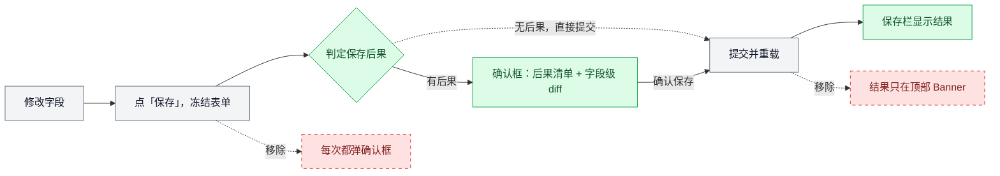
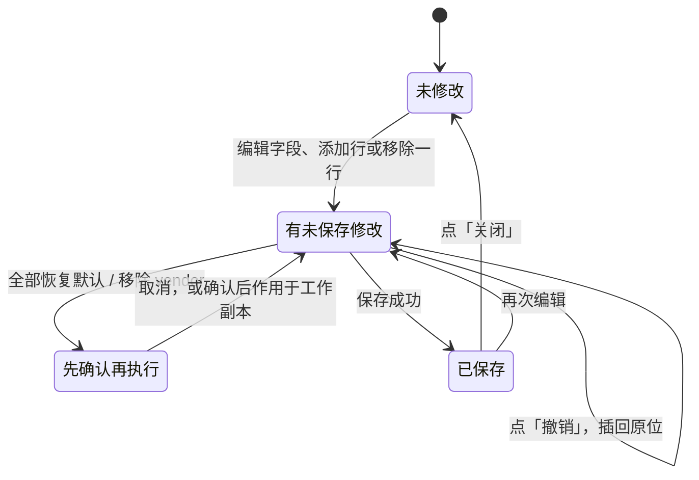

# Config 页第一批体验改造：保存反馈、操作落点、破坏性操作、label 列宽

Jira: N/A — 技术侧发起（Config 页 UI/UX 审计的第一批 1~4 项）
PRD: N/A
Related designs: [Dashboard 看板](../guide/dashboard.md)；[配置字段参考](../arch/config-reference.md)
Author / Reviewers: ThreeFish / 待定

## Summary

Config 页的保存结果改由页面底部的保存栏显示，确认框只在保存会产生实际后果时弹出并列出字段级新旧值；「添加」「排序」「展开」等操作后，新行滚入视口、键盘焦点留在原控件上；「全部恢复默认」和「移除 vendor」先确认，单行移除改为可撤销；label 列在窄窗口下保留 104px 下限，不再截断。改动只在 `config.js` 与 `config.css`，不动服务端 API、`dashboard.py` 外壳与列宽 token。

## Motivation

在长页面下滚后点「保存」，成功、失败、409 的结果都渲染在视口外的页面顶部；每次保存都弹出同一个只列 section 名的确认框，有后果的保存和普通保存看起来一样。同时，Pricing 点「添加」后新行出现在 y=2707（视口高 900），排序、展开、开关分组之后焦点掉回 body，同屏两个同名「恢复默认」作用范围差 9 倍且都不确认。窗口小于约 1260px 时 label 被截断，1024 宽下 vendor 页 22 个 label 截断 11 个。

## Detailed Design

### 1. 保存反馈与确认

保存栏成为唯一的保存结果反馈面。顶部 Banner 只保留模式类提示（`defaults`、`legacy_readonly`、`degraded`、待生效 section）。保存完成后保存栏不消失，切换为结果态，直到用户点「关闭」或再次编辑：

| 结果 | 保存栏表现 | 是否自动消失 |
| --- | --- | --- |
| 已保存并生效 | 绿色圆点 + 文案 + 运行时重置明细（如「配额窗口已按用量数据库重建」）+「关闭」 | 否，再次编辑时清除 |
| 已保存，需重启 | 黄色圆点 + 原因 +「关闭」 | 否 |
| 保存失败（4xx / 5xx / 网络） | 红色圆点 + 原因，保留「放弃修改」「保存」（即重试） | 否 |
| 422 校验错误 | 行内红字不变；保存栏错误链接改为可读字段名（「Timeout（zhipu）：不能为负数」），原路径放进 title | 否 |

结果不自动消失，依据是 W3C APG 对 alert 的要求：「It is also important to avoid designing alerts that disappear automatically」[3]；Atlassian 的 flag 规范同样要求失败与警告不自动消失 [7]。成功结果也不自动消失，是因为保存栏本身常驻底部、不遮挡内容，用户关闭的成本是一次点击。如果后续发现成功提示占位令人厌烦，可改为成功态 6 秒后收起，失败态保持不变。

保存时文案按阶段区分：拉取运行时状态与等待确认期间显示「等待确认…」，提交与重载期间显示「保存中…」。保存栏左侧由「N 个字段待保存（K 个 section）」改为「待保存：Vendors › zhipu、Pricing（3 处）」，按钮只写「保存」，不再重复计数。

确认框改为按后果触发：后果清单为空时直接提交，非空才弹。后果清单只收录保存前能确定的事实：

| 后果 | 判定来源 | 是否危险（红色主按钮） |
| --- | --- | --- |
| 密钥写入、清空或改用环境变量 | 本次载荷的 `secret_ops` | 清空为危险 |
| 目标地址变更将清空已存密钥 | 前端已有的 `predictClearedSecrets()` | 是 |
| 有在途请求 | `/api/status` 的 `in_flight > 0` | 否 |
| 熔断、限流、配额超限状态将重置 | `/api/status` 各 tier 的状态 | 否 |
| 运行中的优先级与保存的 Tiers 不同 | `view.running.tiers` 与工作副本链路 | 否 |
| 上次保存后未生效的 section 会一并生效 | `running.boot_revisions` 与 `revisions` | 否 |
| 移除 vendor（同时移出 Tiers） | 工作副本与 base 的 vendor 差集 | 否（移除时已确认过） |

运行时并发上限被重置这一条不进清单：前端不知道 Overview 是否调整过并发上限，服务端在保存后通过 `reset_runtime` 报告（`generations.py` 的 `_runtime_resets`），它出现在保存栏的结果明细里。旧实现把它写成无条件套话，`in_flight` 为 0 时也输出「进行中的请求：0 个」，这两句被删掉。

确认框列出字段级新旧值（「Timeout：300021 → 300023」）。vendors 按 vendor 名配对，列表型 section 按行键配对（Pricing 用 vendor + model，Model Mapping 用 pattern），配不上的行显示为「新增」或「移除」；超过 8 行时折叠在 `
` 里。密钥字段不进 diff，URL 中的 userinfo 打码。

这样做的依据：NN/g 指出「Do not use confirmation dialogs for routine actions」，并说明对例行操作反复确认会让用户养成不看就点的习惯 [1]；WCAG 3.3.4 的理解文档明确「It is not the intent to require a confirmation for each save command」[4]。

图例：灰色为未变化，绿色为新增，红色虚线为删除。下图是同一流程的 Archify 版本，双主题 SVG，深浅模式自适应；交互版与图源见 [`docs/diagrams/config-save-flow/`](../diagrams/config-save-flow/)。

### 2. 操作后的焦点与落点

`rerender()` 在清空 DOM 之前记录焦点所在控件的「容器路径 + 控件角色」，重建后按同一键找回焦点。容器路径用现有的 `data-path`、`data-pill`、`data-vendor` 属性，角色取 `aria-label`、按钮文案或控件类名。找不到同一控件时依次退到：同一容器里的同类按钮（「编辑」变成「收起」时）、同一容器里的第一个可聚焦控件、当前激活的 pill。目标控件被禁用时跳过（排序到首行后「上移」禁用，焦点落到同行「下移」）。

需要显式落点的操作由调用方指定：

| 操作 | 落点 |
| --- | --- |
| 列表「添加」 | 新行的编辑表单滚到视口中部，焦点在第一个输入框，新行高亮 2 秒 |
| 上移 / 下移 | 被移动行的同一颗按钮（按移动后的下标重映射） |
| 移除一行 | 同位置下一行的「编辑」；表已空时落到该表的「添加」 |
| 切换 section / vendor | 新的激活 pill |
| 密钥菜单「设置新值」 | 新值输入框（现状已如此）；其余选项留在菜单上 |
| 确认框取消 | 打开它的控件（保存时为「保存」按钮） |
| Per-Model 添加 / 移除 | 「模型名」输入框 / 「添加」按钮 |

焦点原本由键盘获得时，重建后用 `data-focus-ring` 属性补画焦点环，因为脚本调用 `focus()` 不会触发浏览器的 `:focus-visible`。依据：Primer 焦点管理规范要求移除或重绘内容后「focus should return to a logical spot」，否则会回到 body、用户需要从头遍历整页 [9]；WCAG 2.4.3 要求焦点顺序保留操作的连贯性 [5]。

表单卡 `.cfg-body` 继承全局 `.card` 的 400ms 入场动画与 hover 阴影，每次重建都重放。本次在 `config.css` 里用 `.card.cfg-body { animation: none }` 关掉，不改 `dashboard.py` 的全局规则，Overview 的卡片不受影响。整行点击展开时，若用户刚拖选了文字则不展开，保留表格文字可复制。

保存栏常驻时，页面设置 `scroll-padding-bottom: 120px`，键盘聚焦到页面底部的控件时浏览器会把它滚到保存栏上方，满足 WCAG 2.4.11 [6]。`:has()` 需要 Chrome 105、Safari 15.4、Firefox 121 以上；更老的浏览器只是失去这一条滚动补偿。

### 3. 破坏性操作：确认与撤销的分界

确认框与撤销按作用范围分工：范围超出当前可见对象时先确认，只影响当前列表里一行时不确认、给撤销。

| 操作 | 改造前 | 改造后 |
| --- | --- | --- |
| Vendors 子 pill 行「恢复默认」（重置全部 vendor） | 与 vendor 级同名同样式，无确认 | 改名「全部恢复默认」，降为透明底按钮；总是确认，写明「全部 9 个 vendor」与「其他 vendor 上未保存的修改也会丢弃」 |
| vendor 级「恢复默认」 | 无确认 | 该 vendor 有已保存的自定义值时确认，否则直接执行 |
| 其他 section 的「恢复默认」 | 无确认 | 该 section 已覆盖包内默认时确认，否则直接执行 |
| 移除 vendor | 无确认，无提示 | 确认，写明会移出 Tiers 链路及当前位次、已存密钥不删除；执行后保存栏给「撤销」 |
| 移除表格行 / Per-Model 行 | 「删除」，无确认，无撤销 | 动词改「移除」；不确认，保存栏给「撤销」（插回原位） |
| 放弃修改、锁定、脏态刷新 | 原生 `window.confirm` | 页面内确认框，主按钮红色 |

撤销只保留最近一次移除，撤销时只把被移除的对象插回原位，不回滚它之后的其它编辑；保存、放弃修改、锁定、重新加载或下一次结构性操作（添加、排序、重新添加 vendor）会清掉撤销入口，保存进行中「撤销」按钮禁用。「恢复默认」不提供撤销，因为它已经确认过，且保存前可用「放弃修改」整体找回。

依据：Raskin 的「Never use a warning when you mean undo」[2] 与 NN/g「Use a confirmation dialog before committing to actions with serious consequences」[1] 分别对应撤销和确认两侧；Primer 把 danger 按钮定义为「Used sparingly for destructive actions, typically prompt a confirmation dialog」[8]；APG 建议不可逆操作的确认框把初始焦点放在「the least destructive action」[3]，所以确认框打开时焦点在「取消」。四处原生 `window.confirm` 换成页面内确认框，是为了统一按钮文案、危险样式与焦点归还；破坏性确认使用 `alertdialog` 角色，正文与后果清单通过 `aria-describedby` 关联，焦点落在「取消」时读屏也会读出；不支持 `<dialog>` 的环境仍回退到 `window.confirm` 并同步执行，Node 测试环境走这条分支。

工作副本在编辑、确认与撤销之间的状态：

交互版与图源见 [`docs/diagrams/config-edit-undo/`](../diagrams/config-edit-undo/)。同一状态机的文本版：

### 4. label 列宽下限

`.cfg-row` 的列定义由 `calc(100% / 12)` 改为 `minmax(104px, calc(100% / 12))`。卡片内宽约 1250px 以上时（视口约 1314px 以上），label 列仍精确等于行宽的 1/12，与现状逐像素一致；更窄时 label 列停在 104px。104px 的来源：注册表里 label 最长 14 个 ASCII 字符（`test_spec_constraints` 钉住），实测最宽的「Fail Threshold」「Max Recovery」需要 91px，加 `.cfg-label` 的 6px 右内边距为 97px，再留 7px 余量。

视口 640px 以下，label 与 ⓘ 占第一行（ⓘ 紧跟 label），控件独占第二行；在 390px 宽下控件可用宽度从约 150px 增加到约 270px，说明气泡改为在该行下方展开并限宽，不再伸出视口。

label 被截断时，渲染完成后立即补 `title`（原先只在鼠标移入时懒补，键盘与触屏拿不到）；表单行 ⓘ 的说明首行带上完整 label（「Timeout：单次请求超时」）。

实测效果（同一隔离实例、包内默认配置，分别加载改造前后的 `config.js` / `config.css`）：

| 视口 | label 列宽（前 → 后） | vendor 页截断数（前 → 后，共 22 个） |
| --- | --- | --- |
| 1440 | 111px → 111px | 0 → 0 |
| 1280 | 97px → 104px | 0 → 0 |
| 1024 | 76px → 104px | 11 → 0 |
| 768 | 55px → 104px | 15 → 0 |
| 390 | 23px → 整行 | 22 → 0 |

### 5. Test plan

| 风险 | 测试级别 | 断言 |
| --- | --- | --- |
| 保存结果位置迁移 | Node DOM harness（`test_config_js_rendering_under_node`） | 步骤 6：结果文案出现在 `.cfg-savebar`，顶部 Banner 不含「已保存」；无后果的保存不调用 `confirm` |
| 结果态可关闭 | 同上 | 步骤 7：重载成功后保存栏可见且含「已保存并生效」，点「关闭」后隐藏 |
| Google Secret 单独保存文案 | 同上 | 步骤 9：读取位置从 Banner 改为保存栏，断言内容不变 |
| 行级移除可撤销 | 同上 | 步骤 1：移除不调用 `confirm`；保存栏出现「撤销」；撤销后行数恢复、`isDirty()` 为 false |
| 后果清单与字段 diff | 纯函数 harness（`test_config_js_pure_helpers_under_node`） | 新增 `saveImpact`、`changedRows` 用例：无后果返回空数组；`in_flight > 0`、clear、地址变更各产生对应条目；Pricing 按 vendor + model 配对，删除一行输出 `removed` |
| 焦点找回与新行定位 | Node DOM harness + 隔离实例浏览器回归 | harness：排序后焦点落在被移动行的同一颗按钮，「添加」后焦点落在新行自己的编辑表单；浏览器回归：开关分组、Tiers 勾选与排序、Model Mapping 排序与展开、密钥菜单、Per-Model 添加、切换 pill、确认框取消与结果关闭后焦点都不落回 body |
| 撤销 | Node DOM harness | 行级移除后保存栏出现「撤销」，撤销后行数与脏态恢复；Per-Model 行移除后「撤销」恢复该模型上限；移除 vendor 后撤销把它插回 vendors 与 tiers 原位，期间重新添加会清掉撤销入口 |
| label 列宽 | 隔离实例浏览器回归 | 1024 / 768 / 390 下 vendor 页截断数为 0；1440 下 label 列仍为 111px |

`test_dashboard_config_tab.py` 现有 11 个 DOM 场景中，随本设计调整断言的只有上表前 4 条，其余场景断言不变。

## Drawbacks

- 保存栏在结果态常驻，直到用户关闭或再次编辑。习惯了「保存完自动收起」的用户需要多点一次「关闭」。
- 焦点找回依赖控件角色的启发式匹配：两个同类按钮在同一容器里时，按顺序取第一个可聚焦的。表格行内两个以上同名按钮的场景目前不存在，后续新增时需要补显式落点。
- 撤销只有一级，连续移除两行只能撤销后一次；「恢复默认」不可撤销。
- `config.js` 增加约 420 行（1290 → 1713），主要是确认框、字段 diff 与焦点管理。没有引入依赖，仍是 vanilla ES2017。
- 运行时并发上限重置无法在保存前提示，只能在结果明细里事后报告。
- 961 到 1313px 视口之间，label 列不再精确等于行宽 1/12（固定 104px），这是对现有表单规范的有意偏离。

## Alternatives

- **toast 显示保存结果**：否决。Primer 的可访问性规范写明「Toasts pose significant accessibility concerns and are not recommended for use」[10]，且 toast 自动消失，失败原因可能来不及读。
- **结果仍在顶部，保存后把页面滚回顶部**：否决。用户刚编辑的位置会丢失，长页面上来回跳动。
- **保留每次必弹的确认框，只补字段 diff**：否决。WCAG 3.3.4 明确不要求每次保存都确认 [4]；NN/g 认为例行确认会被习惯性跳过 [1]。字段 diff 在有后果时更值得看。
- **所有破坏性操作都弹确认，不做撤销**：否决。行级移除是高频小操作，每次确认会让确认框失去提醒作用 [1][2]。
- **按 section 增量更新 DOM，从根本上避免整页重建**：本期不做。1290 行文件与 Node DOM 测试桩都建立在整页重建之上，改动面远大于焦点找回，而焦点找回已覆盖可观测的问题。
- **label 列按断点切换比例（如 1440 以下改 1/8）**：否决。仍会在某个宽度截断，下限方案只在截断即将发生时介入。

## Unresolved Questions

None. 与本设计相关的两条规范裁决已由负责人确定：label 列在 1/12 之外加 104px 下限、视口 640px 以下 label 与控件分行；确认框按保存后果触发。

## References

1. J. Nielsen, "Confirmation Dialogs Can Prevent User Errors — If Not Overused," Nielsen Norman Group, Feb. 2018. [Online]. Available: https://www.nngroup.com/articles/confirmation-dialog/
2. A. Raskin, "Never Use a Warning When you Mean Undo," *A List Apart*, no. 241, Jul. 2007. [Online]. Available: https://alistapart.com/article/neveruseawarning/
3. W3C WAI, "Dialog (Modal) Pattern" and "Alert Pattern," *ARIA Authoring Practices Guide*. [Online]. Available: https://www.w3.org/WAI/ARIA/apg/patterns/dialog-modal/ ; https://www.w3.org/WAI/ARIA/apg/patterns/alert/
4. W3C WAI, "Understanding SC 3.3.4: Error Prevention (Legal, Financial, Data)," *WCAG 2.2 Understanding*. [Online]. Available: https://www.w3.org/WAI/WCAG22/Understanding/error-prevention-legal-financial-data.html
5. W3C WAI, "Understanding SC 2.4.3: Focus Order," *WCAG 2.2 Understanding*. [Online]. Available: https://www.w3.org/WAI/WCAG22/Understanding/focus-order.html
6. W3C WAI, "Understanding SC 2.4.11: Focus Not Obscured (Minimum)," *WCAG 2.2 Understanding*. [Online]. Available: https://www.w3.org/WAI/WCAG22/Understanding/focus-not-obscured-minimum.html
7. Atlassian, "Flag — Usage," *Atlassian Design System*. [Online]. Available: https://atlassian.design/components/flag/usage
8. GitHub, "Button," *Primer Product UI*. [Online]. Available: https://primer.style/product/components/button
9. GitHub, "Focus management," *Primer Accessibility*. [Online]. Available: https://primer.style/accessibility/design-guidance/focus-management
10. GitHub, "Accessible notifications and messages," *Primer Accessibility*. [Online]. Available: https://primer.style/accessibility/patterns/accessible-notifications-and-messages/
11. W3C WAI, "Understanding SC 4.1.3: Status Messages," *WCAG 2.2 Understanding*. [Online]. Available: https://www.w3.org/WAI/WCAG22/Understanding/status-messages.html
