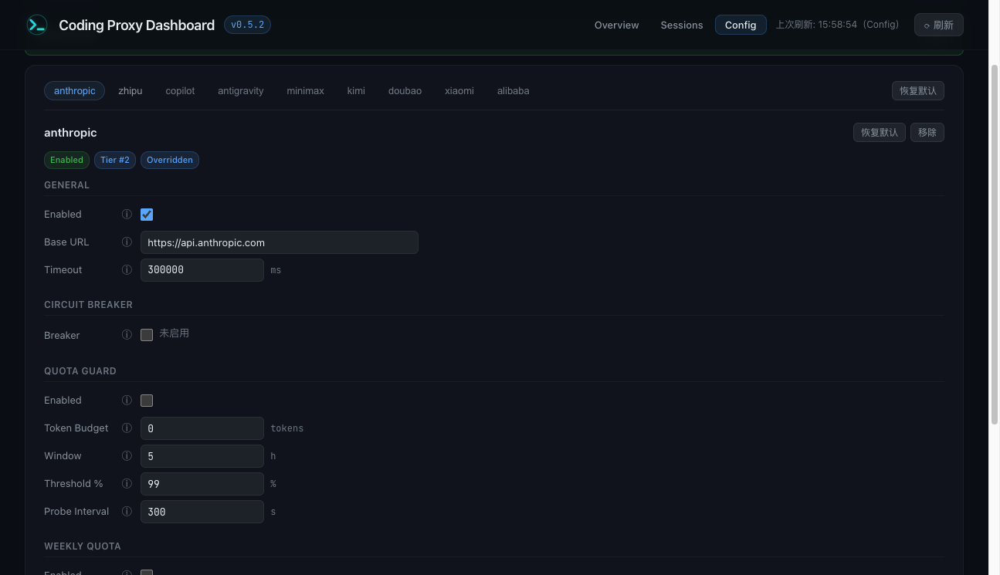

# Dashboard 看板

coding-proxy 内置 Web 可视化看板，提供流量、用量、故障转移等关键指标的实时监控。

## 访问

启动代理后，浏览器访问：

```
http://127.0.0.1:3392/dashboard
```

## 功能概览

### KPI 卡片

顶部展示核心指标：

| 卡片             | 说明                                       |
| ---------------- | ------------------------------------------ |
| 今日请求数       | 当日总请求数（子行显示本周累计）           |
| 今日 Token 总量  | 当日总 Token 消耗（子行显示本周累计）      |
| 今日输出 Token   | 当日输出 Token 数（子行显示本周累计）      |
| 今日费用估算     | 基于定价配置的费用估算（子行显示本周累计） |
| 故障转移（今日） | 当日故障转移事件数（子行显示本周累计）     |
| 平均延迟（今日） | 当日请求平均响应时间（子行显示本周累计）   |

### 图表

| 图表                          | 说明                                 |
| ----------------------------- | ------------------------------------ |
| 供应商状态                    | 各供应商实时状态（熔断器、配额守卫） |
| 请求时间线                    | 按天的请求量趋势图                   |
| 供应商分布                    | 各供应商请求占比甜甜圈图             |
| Token 时间线（按供应商）      | 各供应商按天的 Token 消耗堆叠图      |
| Token 时间线（按供应商+模型） | 细粒度的模型级 Token 消耗堆叠图      |

### 供应商状态复位

「供应商状态」卡片标题栏右侧提供 **⟲ 状态复位** 按钮，用于把处于熔断 / 限流等异常态的供应商一键复位为可正常访问。等价于 [`POST /api/reset`](./api-reference.md#6-post-apireset) 的**无 body** 形态：

| 复位                                                       | 保留                                                        |
| ---------------------------------------------------------- | ------------------------------------------------------------ |
| 熔断器状态（→ CLOSED，「熔断 ×N」徽章转「正常」）          | 配额窗口用量（「1d配额 45%」徽章数值不变）                  |
| 配额守卫状态（用量未超阈值 → WITHIN_QUOTA；确已超阈值 → 保持 EXCEEDED，但仍清除 cap 卡死标志并还原探测间隔） | 供应商优先级顺序（无 body 即不触发重排序）                  |
| Rate Limit 冷却截止时间（→ 清除，「限速中」徽章消失）      | 数据库用量记录（`coding-proxy usage` 统计不受影响）         |

执行期间按钮进入禁用态并显示「复位中…」，成功后短暂显示「✓ 已复位」并立即重渲染供应商列表（不必等 10 分钟轮询），失败显示「✗ 失败」，详情见浏览器控制台。

> 若某供应商的窗口用量**确实**已超过配额阈值，复位不会放行它 —— 用量数字不会被伪造，守卫保持 `QUOTA_EXCEEDED`；但 cap 错误卡死标志会被清除、探测间隔还原为默认值，探测恢复不会被推迟。

### 时间范围选择器

页面右上角提供时间范围选择：

- **7 天**（默认）
- **30 天**
- **自定义天数**（1~90 天）

### Config 页（在线配置）

Config 页签在线编辑配置存储（`~/.coding-proxy/config.db`）：Vendors（9 类供应商，含熔断 / 配额 / 并发等弹性参数与密钥三态控件）、Tiers、Failover、Model Mapping、Pricing（$ / ¥ 双币种）、Native API、Session Policies，以及 System（bootstrap 字段只读展示 + 迁移状态）。

- **解锁**：首次进入粘贴 admin token（`coding-proxy config token` 输出），仅存于本浏览器；管理 API 只认 `X-Coding-Proxy-Admin` 请求头。
- **保存**：单一 Save 汇总「Save N fields in K sections」，确认框列出将被重置的运行时状态与因目标地址变化被清空的密钥；保存后**进程内热切换生效，无需重启**。
- **冲突与校验**：并发修改返回 409（只重载冲突 section）；校验错误定位到具体字段行内展示，且从不回显输入值。
- **密钥**：只写不读，展示 Stored / Env / Empty 状态与尾 4 位（长度 ≥ 16 时）；vendor 目标地址变化时自动清空关联密钥并在确认框提示。



### 自动刷新

看板每 **10 分钟**自动刷新数据。也可点击右上角「刷新」按钮手动刷新。Config 页不参与定时刷新（避免覆盖编辑中的表单）。

### 图表交互

- **单击**图例项：隔离显示该系列
- **Ctrl+单击**图例项：多选显示
- **Shift+单击**图例项：排除该系列

## 数据源

看板数据来自以下 API 端点，详见 [API 参考 — Dashboard 端点](./api-reference.md#12-dashboard-端点)：

| 端点                          | 说明                 |
| ----------------------------- | -------------------- |
| `GET /api/dashboard/summary`  | KPI 汇总数据         |
| `GET /api/dashboard/timeline` | 按天分组的时间线数据 |
